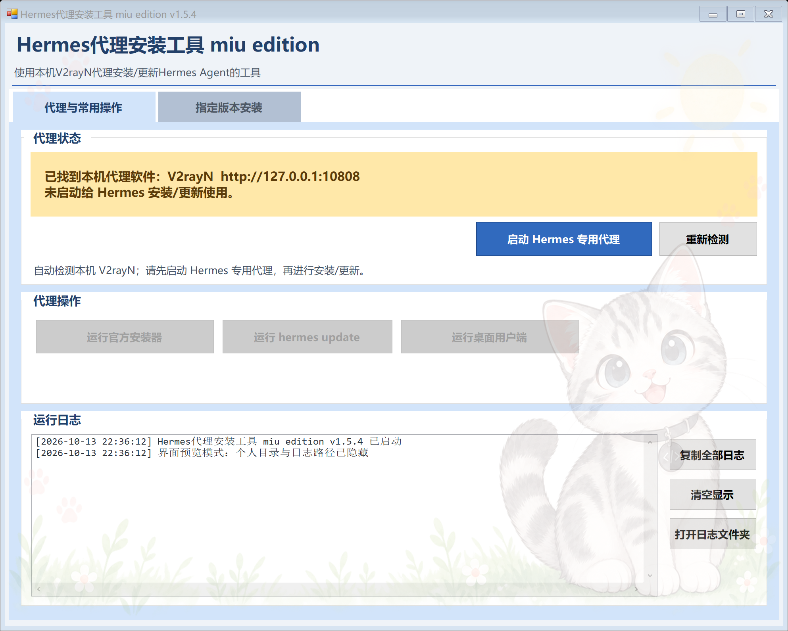

# Hermes Proxy Bridge

Windows 10/11 上的 Hermes 安装、更新和 Desktop 专用代理启动器。它只向自己启动的进程树注入代理环境变量，不修改 V2rayN 配置、Windows 系统代理或 WinHTTP。

当前版本：**v1.5.4**



## 主要功能

- 自动读取 V2rayN 写入的当前用户 Windows 代理，不提供手动代理地址输入，避免界面与状态产生两套来源。
- 通过代理启动官方 `Hermes-Setup.exe`、`hermes update` 和 Hermes Desktop。
- 输入 7～40 位 Git 提交号、Hermes 发布标签或显式分支，安装指定版本。
- 只读检测本机 Hermes 的源码版本、当前提交、分支、精确标签、安装标记和未提交改动。
- 版本选择保存在 EXE 同目录的 `HermesProxyBridge.ini`，可随整个文件夹复制到另一台电脑。
- 查询 GitHub 官方 `/releases/latest`：
  - 显示最新稳定版名称和标签；
  - 排除 `draft` 和 `prerelease`；
  - 可打开官方发布页；
  - 点击获取后自动把稳定版标签填入指定版本框并持久化。
- 本机当前版本号与官网最新稳定版本号并列显示；点击任一获取按钮都会自动填入指定版本框并保存到随附 INI。
- 标签/短提交通过代理解析成 40 位 SHA；下载该提交自己携带的官方 `scripts/install.ps1`，校验关键参数后再执行。
- 指定版本安装使用官方脚本的阶段协议，逐阶段显示“当前安装内容”、进度条和退出结果，不再依赖外部 CMD 黑框判断状态。
- “安装细节”可在右侧展开，实时显示 PowerShell、Git、uv、pip、npm 和 Desktop 构建的 stdout/stderr；完整 UTF-8 日志另存为 `%LOCALAPPDATA%\HermesProxyBridge\logs\install-*.txt`。
- 安装脚本使用 Bridge 专属 Git 配置（`autocrlf=false`、`longpaths=true`），避免精确提交在新克隆后因换行或长路径失败，同时不修改用户全局 Git 配置。
- 为 Electron 的 `@electron/get` 下载器显式设置代理开关，避免 npm 走代理、Electron 二进制却直连而出现 `socket hang up`。
- 每个安装阶段连续 300 秒无输出会自动终止整个子进程树并写明超时原因；单阶段最长 45 分钟。
- 首个安装脚本下载和每个分阶段安装任务遇到可恢复网络故障时，最多尝试 3 次，等待 3 秒、7 秒后重试；只重试当前失败阶段，不重跑已完成阶段，语法或配置错误不会盲目重试。
- 未检测到 V2rayN 时以大字号红色状态条和弹窗提示“没有启动代理”，不会无说明退出。
- 将“发现 V2rayN”和“已启动 Hermes 专用代理”分成两个明确状态；启动按钮会切换为关闭按钮，未启动专用代理时安装、更新和桌面端操作保持禁用。
- 两个功能页都保留可选择、可 `Ctrl+C`、可一键复制的运行日志。
- 内嵌淡色猫咪、爪印、阳光和草地透明水印，无需携带外部图片；水印位于按钮、文本框、日志框和面板之上并允许鼠标穿透，因此不会被控件遮挡，也不影响点击、输入或日志复制。
- 背景只缓存和绘制一次，主窗体与主要布局容器使用双缓冲，页签切换采用暂停布局后的单次刷新，避免旧版在切页时多层背景连续重绘造成的闪烁。
- 页签切换会递归冻结页面及其原生子控件的绘制，完成一次布局后再统一提交完整画面；重复点击当前页签不会触发刷新，代理状态未变化时也不会每三秒重复改写控件属性。
- 两个页面的原生控件句柄会在窗口首次显示、DPI 已确定后一次性预热，首次切页不会再临时创建隐藏页控件。

## 使用

1. 启动 V2rayN，并开启系统代理；Bridge 会自动检测当前 HTTP/mixed 代理地址。
2. 打开发布目录中的 `HermesProxyBridge.exe`。
3. 点击“启动 Hermes 专用代理”，确认状态区变为绿色。
4. 安装指定版本时：
   - 点击“获取本机当前版本号”，自动填入当前电脑的精确提交；或
   - 点击“获取官方最新稳定版本号”，自动填入稳定版标签；或
   - 手动输入提交号/标签。
5. 点击“安装上述指定版本”。执行前仍会显示确认窗口。
6. 安装时可点“安装进度”展开右侧输出；失败时细节会自动展开，并提示完整日志文件位置。

“运行官方安装器”不会读取版本框，它仍按官方安装器的默认逻辑安装。版本框只作用于“安装上述指定版本”。

## 跨电脑携带版本选择

检测或输入版本后，程序会在 EXE 旁生成 `HermesProxyBridge.ini`。复制时请复制整个程序文件夹，至少同时包含：

- `HermesProxyBridge.exe`
- `HermesProxyBridge.ini`

代理开关和上次安装器路径属于机器专属设置，保存在 `%LOCALAPPDATA%\HermesProxyBridge\settings.ini`，不会跟随便携版本文件迁移。

## 构建

无需 Visual Studio、NuGet 或联网。使用 Windows 自带的 .NET Framework C# 编译器：

```powershell
.\build.ps1
```

输出文件：`artifacts\HermesProxyBridge.exe`

## 安全预检

以下命令不会执行 Hermes 安装或更新：

```powershell
.\artifacts\HermesProxyBridge.exe --self-test
.\artifacts\HermesProxyBridge.exe --self-test-timeout
.\artifacts\HermesProxyBridge.exe --self-test-retry
.\artifacts\HermesProxyBridge.exe --detect-version
.\artifacts\HermesProxyBridge.exe --check-latest-stable
.\artifacts\HermesProxyBridge.exe --verify-install-source "v2026.9.24"
```

`--verify-install-source` 会解析版本、下载并校验官方脚本，但不会执行该脚本。

详细测试边界见 [docs/TESTING.md](docs/TESTING.md)，代理及安全模型见 [SECURITY.md](SECURITY.md)。

## 已知限制

- Bridge 自身查询 GitHub 和下载脚本需要 HTTP 或 mixed 代理端口；纯 SOCKS 地址不适用于这两步。
- 精确提交必须属于官方安装脚本所选的 `main` 分支，否则官方脚本会安全拒绝。
- 很老的 Hermes 提交若没有兼容的 `-Commit`、`-Branch` 或 `-IncludeDesktop` 参数，会被 Bridge 拒绝。
- 安装旧版本后再执行 `hermes update` 或 Desktop 内更新，可能升级离开旧提交；“指定版本安装”不是永久版本锁。
- 程序未做代码签名，Windows SmartScreen 可能显示“未知发布者”。

## 仓库结构

```text
.
├── .github/workflows/build.yml
├── docs/
│   ├── AUDIT-v1.4.md
│   ├── AUDIT-v1.5.md
│   ├── AUDIT-v1.5.1.md
│   ├── AUDIT-v1.5.2.md
│   ├── AUDIT-v1.5.3.md
│   ├── AUDIT-v1.5.4.md
│   ├── ui-v1.5.4.png
│   ├── ui-v1.5.4-version.png
│   └── TESTING.md
├── assets/cat-ui-overlay-v2.png
├── releases/v1.4.0/
├── releases/v1.4.1/
├── releases/v1.5.0/
├── releases/v1.5.1/
├── releases/v1.5.2/
├── releases/v1.5.3/
├── releases/v1.5.4/
├── src/HermesProxyBridge.cs
├── src/HermesProxyBridge.exe.manifest
├── .gitignore
├── CHANGELOG.md
├── CONTRIBUTING.md
├── README.md
├── SECURITY.md
└── build.ps1
```
